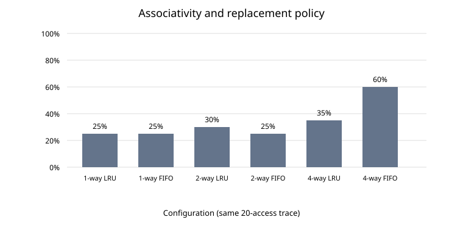

# Cache sweep: interpretation

## Question

How do associativity and replacement policy affect hit rate for the supplied 20-access memory trace?

## Controlled setup

- Same 20-access trace for every run.
- Cache capacity: 256 bytes.
- Cache line size: 64 bytes.
- Policies: LRU and FIFO.
- Associativity: 1, 2 and 4 ways.
- The simulator uses write-allocate and write-back semantics.

## Measured results

| Ways | Policy | Hits | Misses | Hit rate |
|---:|---|---:|---:|---:|
| 1 | LRU | 5 | 15 | 25% |
| 1 | FIFO | 5 | 15 | 25% |
| 2 | LRU | 6 | 14 | 30% |
| 2 | FIFO | 5 | 15 | 25% |
| 4 | LRU | 7 | 13 | 35% |
| 4 | FIFO | 12 | 8 | 60% |

## Interpretation

1. On this trace, the 4-way FIFO configuration has the highest observed hit rate (60%).
2. Increasing associativity does not guarantee monotonic improvement for every replacement policy: 2-way FIFO is equal to the 1-way baseline here.
3. FIFO outperforming LRU at 4 ways is a workload-specific result. It is not evidence that FIFO is generally superior. The trace's access order and the exact replacement decisions determine the outcome.
4. All configurations perform the same number of memory accesses. This is a controlled comparison of cache geometry and replacement policy on one fixed trace.
5. One short synthetic trace is not representative of general workloads. Repeat with sequential, streaming, looping, random, and conflict-heavy traces before making broader claims.

## Limitations

This model has one cache level, no timing or concurrency model, and no CPU pipeline. It reports hit/miss behaviour and dirty writebacks only. It does not model Spectre or establish any real-CPU security property.
